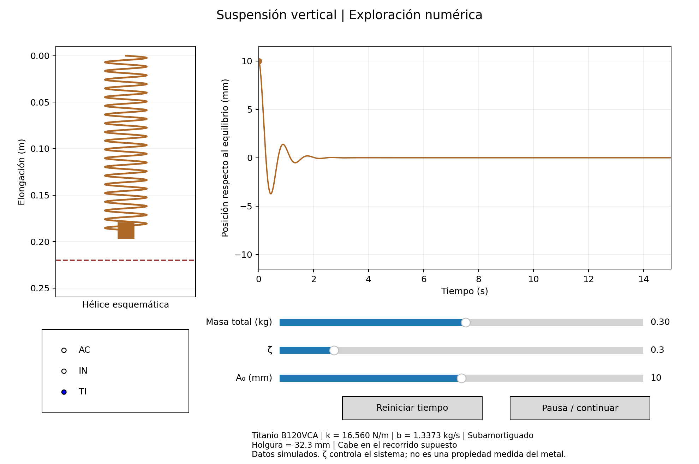
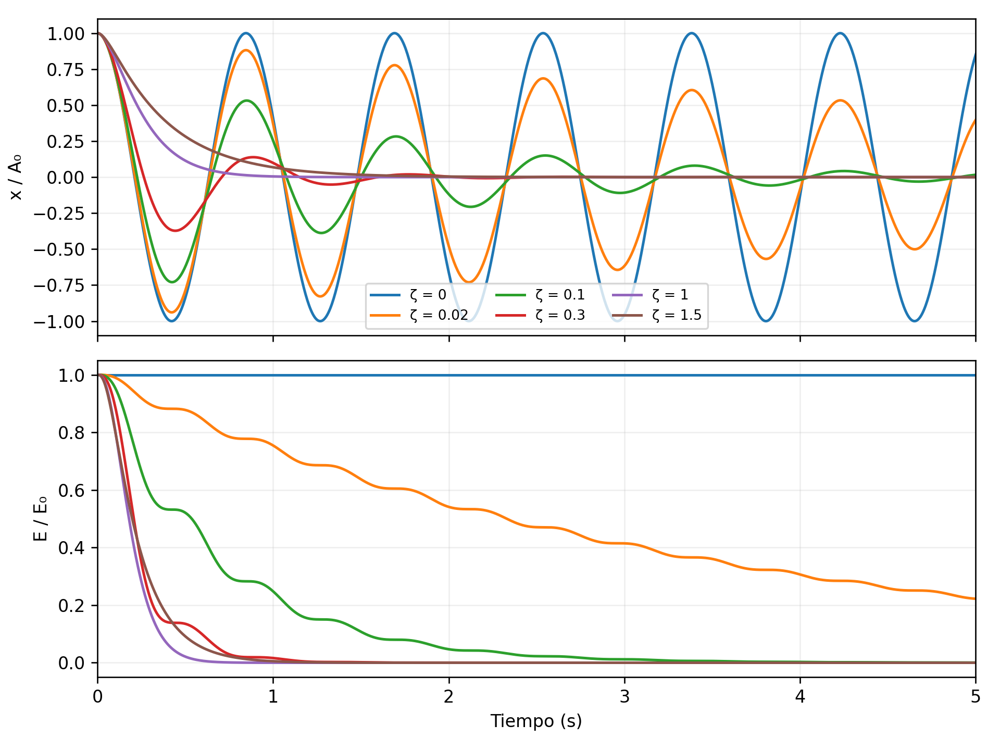

# Simulador de resortes — Física 3

Proyecto del grupo F1B de la UIS. Simula una suspensión vertical y compara el acero Oteva 90 (AC), el acero inoxidable AISI 302 (IN) y el titanio B120VCA (TI).

**Todos los datos generados son simulados.** Esta implementación reproduce el modelo y el procedimiento descritos en el informe; no contiene mediciones de CASSY-Lab. El script original del informe no estaba disponible, por lo que las diferencias entre las nuevas series sintéticas y las cifras históricas se exportan por separado.



## Inicio rápido

Requiere Python 3.11 o posterior. Para abrir la interfaz, use una instalación de escritorio con Tcl/Tk. La exportación de archivos también funciona sin pantalla.

En Windows: ejecute `instalar.bat`, después `verificar.bat` y finalmente `abrir_simulador.bat`. `generar_resultados.bat` produce las tablas, gráficas y el GIF.

En Linux o macOS:

```bash
python3 -m venv .venv
.venv/bin/python -m pip install -r requirements.txt
.venv/bin/python pruebas.py
.venv/bin/python simulador.py --interactivo
```

Para generar el análisis completo:

```bash
.venv/bin/python simulador.py --salida resultados/ensayo_01
```

En Windows sustituya `.venv/bin/python` por `.venv\Scripts\python.exe`. La carpeta de salida debe ser nueva. Use `--sin-gif` para omitir la animación, `--verificar` para ejecutar solo la comparación analítica o `--config parametros.json` para cargar una configuración.

## Contenido

| Ruta | Contenido |
| --- | --- |
| [simulador.py](simulador.py) | Modelo físico, ajustes, interfaz y exportación. |
| [DOCUMENTACION.md](DOCUMENTACION.md) | Manual completo: ecuaciones, parámetros, metodología, funciones y uso. |
| [DOCUMENTACION.html](DOCUMENTACION.html) | Manual para abrir e imprimir en el navegador. |
| [parametros.json](parametros.json) | Configuración física y numérica. |
| [referencia_informe.json](referencia_informe.json) | Cifras históricas para comparar, sin usarlas para generar datos. |
| [pruebas.py](pruebas.py) | Nueve pruebas automatizadas. |
| [VALIDACION.md](VALIDACION.md) | Evidencia de ejecución y límites de la comprobación. |
| [resultados_ejemplo](resultados_ejemplo) | Ejecución completa: ocho tablas, series, cinco gráficas, interfaz y GIF. |
| [informe](informe) | Informe final editable en Word y versión PDF. |
| [fuentes](fuentes) | PDF fuente y plantilla institucional suministrados. |

## Verificación realizada

Las nueve pruebas pasaron en Python 3.12.14. Las 18 combinaciones de material y amortiguamiento cumplieron los criterios de comparación analítica y energía. El error máximo de posición fue **8,1612 × 10⁻¹² m**. La exportación completa terminó correctamente; se revisaron las gráficas y se ejercitaron los controles de la interfaz en modo sin pantalla.

Los resultados nominales para la masa total de 0,300 kg son:

| Material | Rigidez (N/m) | Período (s) | Aceleración máxima (m/s²) | Holgura (cm) |
| --- | ---: | ---: | ---: | ---: |
| AC | 31,840000 | 0,609995 | 1,061333 | 11,756910 |
| IN | 28,461538 | 0,645184 | 0,948718 | 10,659730 |
| TI | 16,560000 | 0,845829 | 0,552000 | 3,228261 |

La verificación comprueba el modelo ideal; una validación experimental requiere resortes y sensores reales. Las incertidumbres de ajuste describen los registros sintéticos. La semilla y las versiones se guardan en cada ejecución.


